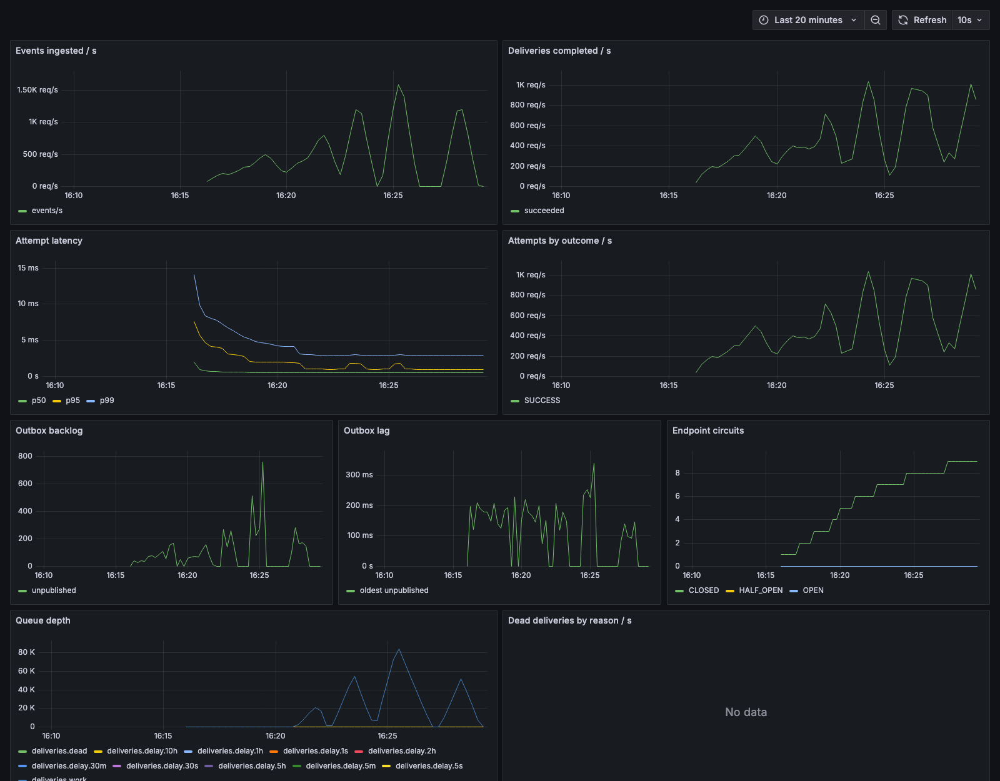
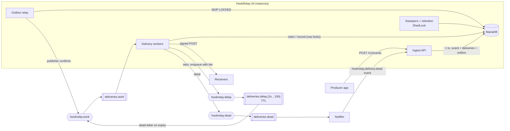

# HookRelay

HookRelay is a multi-tenant webhook delivery service. Your application sends it an event once.
HookRelay signs it, delivers it to every subscribed endpoint, retries for up to three days, stops
calling receivers that keep failing, and shows you every attempt. It covers the work that sits
between "we should send webhooks" and "our webhooks are reliable": an outbox so nothing is lost,
Standard Webhooks signatures, SSRF protection, a circuit breaker per endpoint, replay, metrics and
a dashboard.

Java 21 · Spring Boot 4 · MariaDB 11.4 · RabbitMQ 4 · Flyway · Testcontainers · Prometheus/Grafana



## Architecture



1. **Ingest.** The event, one delivery per subscribed endpoint and one outbox row per delivery are
   written in a single transaction. `202` means it's durable ([ADR 2](docs/adr/0002-transactional-outbox.md)).
2. **Relay.** Unpublished outbox rows go to RabbitMQ with publisher confirms; only confirmed rows
   are marked published.
3. **Deliver.** A worker claims the delivery under a row lock, checking the dispatch token, the
   deadline, the endpoint's status, circuit and rate limit. It signs and POSTs, then records the
   attempt ([ADR 3](docs/adr/0003-database-is-source-of-truth.md)).
4. **Retry.** A failure re-queues the delivery through a TTL "delay tier" queue that dead-letters
   back into the work queue ([ADR 6](docs/adr/0006-fixed-retry-tiers-no-jitter.md)).
5. **Give up.** After the last retry, or when the 3-day window closes, the delivery is `DEAD`. The
   dead-letter consumer emits a `hookrelay.delivery.dead` event, which your own endpoints can subscribe to.

## Features

- **Tenancy:** applications, hashed API keys ([ADR 5](docs/adr/0005-sha256-for-api-keys.md)) and an admin API.
  Every query is scoped by application, and `TenantIsolationIT` calls every resource route as another tenant.
- **Event types** with optional JSON Schema (draft 2020-12) validation of payloads, plus archiving.
- **Endpoints:** subscription filters, pause/resume, soft delete, secret rotation (the old secret
  keeps signing for 24 h), an optional per-endpoint rate limit, and "send test event".
- **Ingest:** exact payload bytes preserved, 256 KiB limit, `Idempotency-Key` (24 h; same key with a
  different body → `422`).
- **Reliability:** transactional outbox, at-least-once delivery, dispatch tokens, a stuck-delivery
  sweeper, and graceful shutdown that lets in-flight sends finish.
- **Failure handling:** retries, a per-endpoint circuit breaker, auto-disable after 3 days without a
  success (emits `hookrelay.endpoint.disabled`), and dead-letter notifications that never loop.
- **Replay** of a single delivery, or every dead delivery of an endpoint since a timestamp.
- **Queries:** keyset-paginated events, deliveries and attempts, plus per-endpoint 24 h stats
  (success rate, p50/p95 latency).
- **Retention:** payloads purged after 30 days, attempts deleted after 90, idempotency keys after
  24 h, published outbox rows after 7 days, in batches of 1,000 under ShedLock.
- **Operations:** Prometheus metrics, ECS JSON logs with delivery/endpoint ids, liveness and
  readiness groups on a separate management port, OpenAPI with Swagger UI, and a provisioned Grafana dashboard.

## Quick start

Requires Docker (with Compose), `curl` and `jq`.

```bash
cp .env.example .env
docker compose up -d --build     # 2 HookRelay instances, MariaDB, RabbitMQ, receiver, Prometheus, Grafana
./scripts/demo.sh                # deliver → break the receiver → retries → DEAD → fix → bulk replay
```

| What | Where |
|---|---|
| API (instance 1 / 2) | http://localhost:8080, http://localhost:8090 |
| Swagger UI | http://localhost:8080/swagger-ui.html |
| Grafana (anonymous) | http://localhost:3000 |
| RabbitMQ console | http://localhost:15672 (credentials from `.env`) |
| Sample receiver | http://localhost:9000/received, `PUT /chaos` |

Local development: `docker compose -f docker-compose.dev.yml up -d`, then
`./mvnw -pl hookrelay-server -am spring-boot:run -Dspring-boot.run.profiles=dev`.
To run the tests, use `./mvnw verify`. It needs Docker; Testcontainers starts MariaDB and RabbitMQ.

## API

All routes take `Authorization: Bearer <key>`: an application key for `/v1/**`, or the admin token for
`/v1/admin/**`. Errors are RFC 9457 `application/problem+json`. Lists are cursor-paginated
(`?limit=&cursor=`). The full reference is in Swagger UI.

| Area | Routes |
|---|---|
| Admin | `POST/GET/PATCH /v1/admin/applications[/{id}]`, `POST/GET/DELETE …/{id}/api-keys[/{keyId}]` |
| Event types | `POST/GET /v1/event-types`, `GET/PATCH /v1/event-types/{name}`, `POST …/{name}/archive`, `…/unarchive` |
| Endpoints | `POST/GET /v1/endpoints`, `GET/PATCH/DELETE /v1/endpoints/{id}`, `POST …/{id}/pause`, `…/resume`, `…/rotate-secret`, `GET …/{id}/secret`, `POST …/{id}/test`, `GET …/{id}/stats`, `POST …/{id}/replay` |
| Events | `POST /v1/events` (`Idempotency-Key`), `GET /v1/events`, `GET /v1/events/{id}`, `GET /v1/events/{id}/deliveries` |
| Deliveries | `GET /v1/deliveries?status=&endpointId=&eventId=&from=&to=`, `GET /v1/deliveries/{id}`, `GET …/{id}/attempts`, `POST …/{id}/replay` |

```bash
curl -X POST localhost:8080/v1/events -H "Authorization: Bearer $KEY" -H 'Content-Type: application/json' \
  -H 'Idempotency-Key: order-1001' -d '{"eventType":"order.created","payload":{"orderId":"1001"}}'
# 202 {"id":"01a1c507-…","deliveryCount":2}
```

## Delivery semantics

- **At least once, no ordering.** Every attempt of an event carries the same `webhook-id`, so
  receivers deduplicate on it ([ADR 4](docs/adr/0004-at-least-once-and-webhook-id.md)).
- **Signed** per [Standard Webhooks](https://www.standardwebhooks.com): `webhook-id`,
  `webhook-timestamp`, `webhook-signature: v1,<base64 HMAC-SHA256 of "id.timestamp.body">`. During a
  secret rotation both signatures are sent. A `hookrelay-event-type` header is also included. The
  sample receiver's `WebhookVerifier` is a reference implementation.
- **Success** is any 2xx within 15 s. Redirects are not followed and count as failures.

| Attempt | 1 | 2 | 3 | 4 | 5 | 6 | 7 | 8 |
|---|---|---|---|---|---|---|---|---|
| Delay after previous failure | – | 5 s | 5 min | 30 min | 2 h | 5 h | 10 h | 10 h |

- **Deadline:** 3 days from the event. Anything not delivered by then is `DEAD` with reason `expired`.
- **Circuit breaker** per endpoint: 10 consecutive failures open it. It then waits 5 min, 30 min, then
  1 h between single half-open probes. While it is open, deliveries wait without spending attempts.
- **Auto-disable:** after 3 days with no success, the endpoint is disabled, its pending deliveries die
  (`endpoint_disabled`) and a `hookrelay.endpoint.disabled` event is emitted. `resume` brings it back.
- **Paused** endpoints park their deliveries; `resume` re-queues them. Deleting an endpoint kills its
  pending deliveries (`endpoint_deleted`), including ones already sitting in a delay queue.

## Security

- API keys are stored as SHA-256 with an indexed prefix; the plaintext is shown once.
  The admin token is separate and configured by environment variable.
- Endpoint signing secrets are encrypted at rest with AES-256-GCM (`HOOKRELAY_ENCRYPTION_KEY`).
- SSRF guard: https only by default, private/loopback/link-local/metadata ranges blocked, checked at
  registration **and before every send** ([ADR 7](docs/adr/0007-ssrf-checked-at-send-time.md)).
- Inbound rate limit per API key (`429` with `Retry-After`) and an optional outbound limit per endpoint
  ([ADR 8](docs/adr/0008-rate-limits-without-redis.md)).
- Containers run as non-root. Actuator listens on its own port (8081), which is not published by Compose.

## Observability

- Metrics (`/actuator/prometheus` on :8081): `hookrelay_events_ingested_total`,
  `hookrelay_deliveries_completed_total{outcome}`, `hookrelay_attempts_total{outcome}`,
  `hookrelay_attempt_duration_seconds` (histogram), `hookrelay_outbox_backlog`, `hookrelay_outbox_lag_seconds`,
  `hookrelay_endpoints_circuit{state}`, `hookrelay_deliveries_dead_total{reason}`,
  `hookrelay_deliveries_recovered_total`. Queue depths come from RabbitMQ's Prometheus plugin.
  No metric is tagged by tenant or endpoint, which keeps label cardinality bounded.
- JSON logs (ECS) in the `prod` and `demo` profiles, with `deliveryId`/`endpointId` from the MDC.
- Health: `/actuator/health/liveness` and `/actuator/health/readiness` (checks the database and the broker).

## Measured performance

From [k6](loadtest/README.md), 60 s of constant-rate ingest per row, followed by draining every delivery.
Hardware: one Apple M4 laptop (10 cores, 16 GB), with everything in Docker (OrbStack) at once: 2 HookRelay
instances (8 worker threads each), MariaDB, RabbitMQ, the receiver, Prometheus, Grafana and k6.

| Target ingest rate | Events | Ingest p95 | Ingest errors | Drain after ingest | Delivery p95 (accepted → 2xx) |
|---|---|---|---|---|---|
| 200/s | 12,001 | 77 ms | 0 % | 1 s | 1.17 s ¹ |
| 400/s | 24,001 | 27 ms | 0 % | 1 s | 233 ms |
| 800/s | 47,882 | 111 ms | 0 % | 25 s | 30.2 s |
| 1,200/s | 72,001 | 121 ms | 0 % | 52 s | 50.9 s |
| 1,600/s | 95,198 ² | 410 ms | 0 % | 93 s | – |

¹ First run after startup (cold JIT). ² k6 dropped 0.8 % of the arrivals at this rate (VU limit), so
1,200/s is the last fully clean run.

What this shows: ingest stays under 150 ms p95 up to 1,200 events/s. On this machine, delivery saturates at
**about 640 deliveries/s** sustained (72,001 deliveries in 112 s). Above that rate events queue up
durably and drain afterwards with no errors. In the 200–1,200/s runs every single delivery was checked
and had ended `SUCCEEDED`. The 1,600/s run drained fully, but its per-delivery check didn't complete.
These numbers come from a single laptop, not a benchmark of the design's limits.

## How I'd scale it

- **Delivery throughput** is the first limit. Start with more instances and worker threads. The next
  steps are per-endpoint queues or a Kafka topic partitioned by endpoint, so one hot or slow endpoint
  can't sit in front of the others.
- **Rate limits** move to Redis token buckets: exact across instances, and no row lock per send.
- **Payloads** move to object storage (S3) with only a pointer in MariaDB; retention becomes a bucket lifecycle rule.
- **MariaDB:** partition `attempts` and `deliveries` by month so retention becomes partition drops,
  then add read replicas for the query API.
- **Egress** goes through a dedicated proxy, so SSRF rules are enforced at the network edge as well.

## Design decisions

1. [RabbitMQ, not Kafka](docs/adr/0001-rabbitmq-over-kafka.md)
2. [Transactional outbox](docs/adr/0002-transactional-outbox.md)
3. [The database is the source of truth](docs/adr/0003-database-is-source-of-truth.md)
4. [At-least-once, deduplicated by `webhook-id`](docs/adr/0004-at-least-once-and-webhook-id.md)
5. [SHA-256 for API keys](docs/adr/0005-sha256-for-api-keys.md)
6. [Fixed retry tiers, no jitter](docs/adr/0006-fixed-retry-tiers-no-jitter.md)
7. [SSRF checked at send time](docs/adr/0007-ssrf-checked-at-send-time.md)
8. [Rate limits without Redis](docs/adr/0008-rate-limits-without-redis.md)

## Repository layout

```
hookrelay-server/     the service (packages: tenant, security, eventtype, endpoint, event, outbox,
                      delivery, notify, stats, jobs, ops, crypto, common)
hookrelay-receiver/   sample receiver: verification, dedupe, chaos switches
ops/                  Prometheus, Grafana provisioning + dashboard, RabbitMQ plugins
loadtest/             k6 script
scripts/demo.sh       end-to-end demo
docs/adr/             design decisions
```
